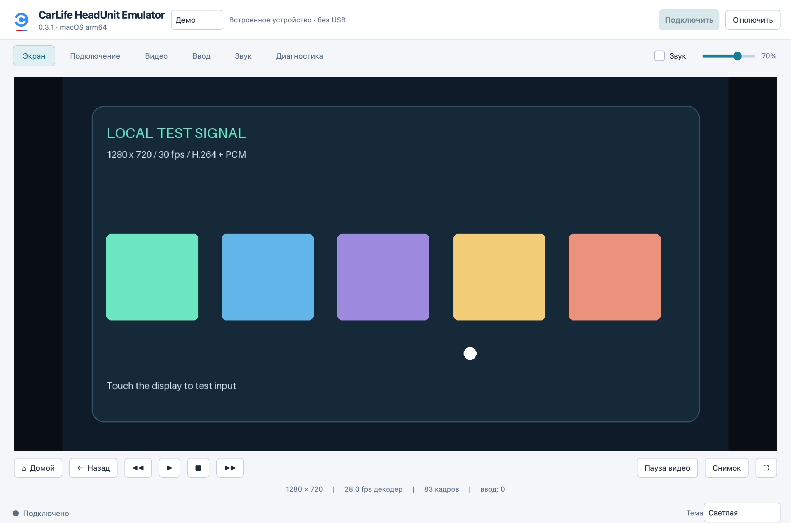
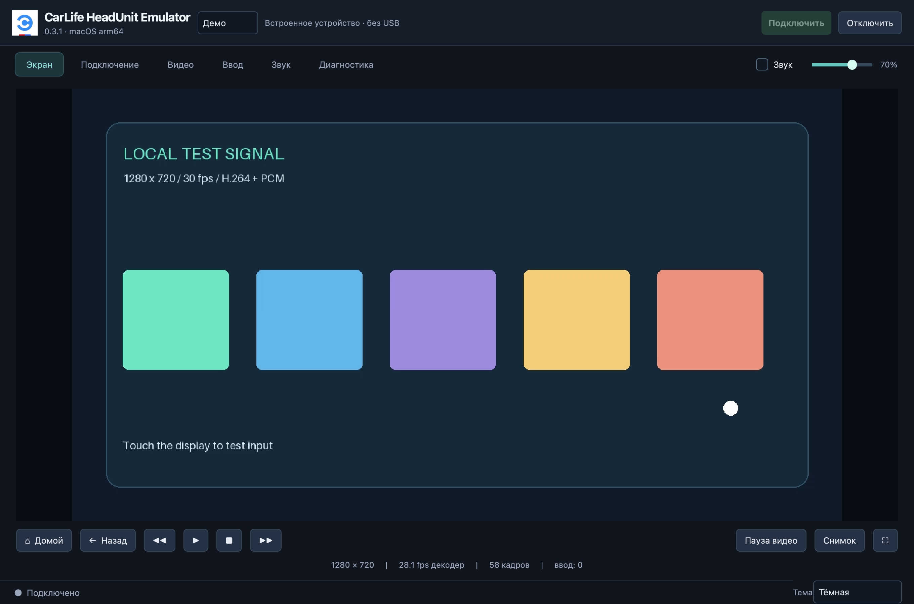

# CarLife HeadUnit Emulator

**Version 0.3.1** · [Русский](README.ru.md) · [Download](https://github.com/SadykovIV/CarLife-HeadUnit-Emulator/releases/latest) · [Changelog](CHANGELOG.md)

An independent hobby desktop application that emulates a Baidu CarLife head unit for testing a compatible phone or Android box. It displays the projected video, plays received audio and sends touch, keyboard and media input. Extracted from [Carlife_on_box](https://github.com/SadykovIV/Carlife_on_box), with one Qt interface and session implementation for macOS and Windows.

**The application interface is currently in Russian.** This is not an official Baidu or Honda product. It does not install Android components or modify device firmware.

## Download and run

Get the appropriate ZIP from [GitHub Releases](https://github.com/SadykovIV/CarLife-HeadUnit-Emulator/releases/latest). Packaged applications include Python and their runtime dependencies.

| Package | Requirements and launch | Validation boundary |
| --- | --- | --- |
| `CarLife-HeadUnit-Emulator-0.3.1-macOS-arm64.zip` | Apple Silicon, **macOS 26+**. Extract and open `CarLife HeadUnit Emulator.app`. | macOS application and synthetic demo tested. USB negotiation, video and HID registration were also checked from source with one HeadSwap device; text delivery is still unverified. |
| `CarLife-HeadUnit-Emulator-0.3.1-Windows-x64.zip` | Windows x64. Extract the **whole folder**, then run `CarLifeHeadUnitEmulator.exe`. | Cross-built package with dependency/hash/PE checks. **Not run on Windows**; Windows GUI, audio, USB drivers and physical HID delivery remain unverified. |

The macOS package has an ad hoc signature and is not notarized; the Windows executable is not Authenticode signed. The current macOS minimum comes from its bundled native libraries. Do not move the Windows executable away from the accompanying runtime files.

Select **«Демо»** (Demo) in the top connection bar to try the application without a device. The demo generates local H.264 video and PCM audio; it does not establish hardware compatibility. You can also launch it with `--demo`:

```sh
open "CarLife HeadUnit Emulator.app" --args --demo
```

```powershell
& '.\CarLifeHeadUnitEmulator.exe' --demo
```

## What it does

- USB Android Open Accessory connection to the selected device. **AOA is always enabled for USB**; scanning the device list does not switch devices into accessory mode. TCP is available for the project's compatible multiplexed lab stream, not arbitrary CarLife Wi-Fi.
- H.264 projection with requested resolution/FPS, negotiated-mode diagnostics, fit/crop, rotation, fullscreen and screenshots. The device decides which stream modes it accepts.
- Mouse touch and up to **two contacts** using trackpad pinch, Alt + mouse drag, Ctrl + wheel (also Cmd + wheel on macOS), or Qt touchscreen events. Legacy dual is the default; Action3 is an explicit compatibility profile.
- Received Media/TTS/VR audio playback, output-device selection, volume, mute and optional PCM/WAV recording. Microphone input is not implemented.
- Optional USB AOA 2.0 HID keyboard, text submission and host-to-device clipboard paste. Navigation and media commands are also available.
- Dark, light and system themes, selected at the bottom right; session logs, counters and report export. Video pixels retain their original colors.

The connection controls stay at the top. Tabs provide **Экран** (Screen), **Подключение** (Connection), **Видео** (Video), **Ввод** (Input), **Звук** (Audio) and **Диагностика** (Diagnostics).

### Light theme



### Dark theme



## Keyboard, clipboard and compatibility

Enable **«Клавиатура по USB»** (USB keyboard) before connecting. This optional HID setting is separate from the always-enabled USB AOA transport. HID registration starts after the CarLife stream is established. The device must accept AOA 2.0 HID registration. Choose **US** or **RU**, select the same **physical keyboard layout on Android**, and keep **Caps Lock off**. Click the remote text field before typing or pasting.

Paste sends local clipboard text as physical key presses **from the computer to the device only**. It does not read the Android clipboard or synchronize clipboards, and it does not use ADB. Supported text is US printable ASCII or the standard Russian ЙЦУКЕН layout and its mapped punctuation; arbitrary Unicode, emoji and automatic mixed-layout input are unsupported. An unsupported character rejects the entire submission. Each submission is limited to 4,096 characters; Enter and Tab retain their usual field actions. Text is not written to session logs.

**Actual text delivery through HID has not been confirmed on physical hardware.** A source run with HeadSwap confirmed USB negotiation, video and HID registration/cleanup; automated HID tests use a fake USB backend. Multitouch behavior also depends on the device's implementation. Commercial OEM authentication, Bluetooth HFP and generic CarLife Wi-Fi are not implemented. On Windows, libusb needs a compatible driver for the selected USB interface; the application does not install or change drivers.

## Run from source

Use Python 3.11+ and install the desktop dependencies so video and Qt tests are available. From the repository root on macOS/Linux:

```sh
python3 -m venv .venv
. .venv/bin/activate
python -m pip install -r requirements-hu.txt
python -m hu_lab.desktop --demo
```

On Windows, use `py -3 -m venv .venv`, activate `.\.venv\Scripts\Activate.ps1`, then run the same `python -m pip` and `python -m hu_lab.desktop` commands. Real USB access additionally needs native libusb; the demo does not open USB. The packaged releases already include libusb.

## Build

On Apple Silicon with native arm64 Python, after creating the environment above:

```sh
python -m pip install -r macos/requirements-build.txt
brew install libusb
./tools/build-mac-headunit
```

Output: `dist/CarLife HeadUnit Emulator.app`. The builder verifies architecture, local signature, runtime imports and native dependency paths. `HU_PYTHON=/absolute/path/to/python` selects a different interpreter; `--libusb /path/to/libusb-1.0.dylib` selects the library.

The Windows x64 builder runs on macOS or Linux with Python, Pillow and LLVM tools (`clang`, `lld-link`, `llvm-dlltool`, `llvm-rc`). On macOS, install LLVM with `brew install llvm`, then:

```sh
./tools/build-windows-headunit
```

It downloads and verifies the pinned dependencies in [windows/dependencies.json](windows/dependencies.json), then writes the portable folder and ZIP to `dist/`. `--cache-dir`, `--dist-dir` and `--replace` are supported. Cross-building does not execute or validate the Windows runtime.

## Test

With the desktop dependencies installed, run the complete suite from the repository root:

```sh
python -m unittest discover
python -m hu_lab.desktop --demo --smoke-test 8 --data-dir /tmp/carlife-smoke
```

Tests cover protocol framing, touch geometry/lifecycle, audio, HID encoding, settings and Qt interactions with a synthetic peer. They require local loopback sockets and use mocked USB; they do not open real USB devices. Without Qt/PyAV, desktop tests may be skipped. The smoke run writes `smoke-report.json` and `smoke-window.png` in the chosen directory. On Windows use a writable Windows path, and run the packaged `Verify.cmd` to check its libraries without connecting a device.

Settings and session data retain the earlier directory name for compatibility: `~/Library/Application Support/CarLife HeadUnit/` on macOS and `%LOCALAPPDATA%\CarLife HeadUnit\` on Windows. Override it with `--data-dir`.

See the [detailed Russian guide](docs/MAC_HEADUNIT_APP.md) for controls, build checks and prior hardware evidence. Project code is [Apache-2.0](LICENSE); dependencies retain their own licenses. The official Baidu CarLife artwork is excluded from that license: see [icon provenance](hu_lab/assets/ICON_SOURCE.json), [NOTICE](NOTICE) and [third-party notices](THIRD_PARTY_NOTICES.md).
