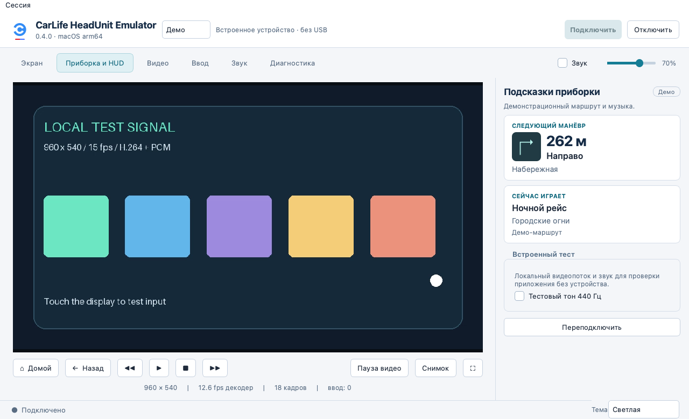
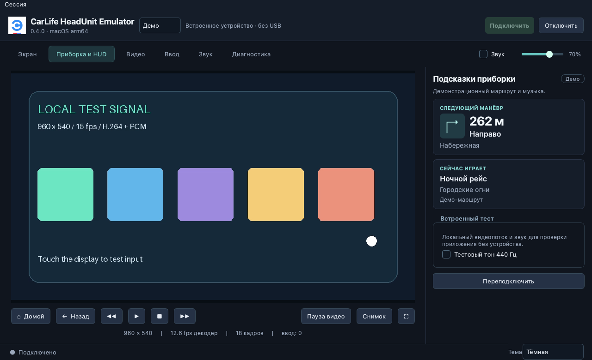

# CarLife HeadUnit Emulator

**Prerelease 0.3.2-rc.3** · [Русский](README.ru.md) · [RC3 downloads](https://github.com/SadykovIV/CarLife-HeadUnit-Emulator/releases/tag/v0.3.2-rc.3) · [Previous stable release: 0.3.1](https://github.com/SadykovIV/CarLife-HeadUnit-Emulator/releases/tag/v0.3.1) · [Changelog](CHANGELOG.md)

An independent hobby desktop application that emulates a Baidu CarLife head unit for testing a compatible phone or Android box. It displays the projected video, plays received audio and sends touch, keyboard and media input. Extracted from [Carlife_on_box](https://github.com/SadykovIV/Carlife_on_box), with one Qt interface and session implementation for macOS and Windows.

**The application interface is currently in Russian.** This is not an official Baidu or Honda product. It does not install Android components or modify device firmware.

## Download and run

Choose the **0.3.2-rc.3** ZIP for your computer. Python, Qt and the other runtime libraries are included.

| Download | Requirements and launch |
| --- | --- |
| [macOS arm64 ZIP](https://github.com/SadykovIV/CarLife-HeadUnit-Emulator/releases/download/v0.3.2-rc.3/CarLife-HeadUnit-Emulator-0.3.2-rc.3-macOS-arm64.zip) | Apple Silicon, **macOS 26+**. Extract and open `CarLife HeadUnit Emulator.app`. |
| [Windows x64 ZIP](https://github.com/SadykovIV/CarLife-HeadUnit-Emulator/releases/download/v0.3.2-rc.3/CarLife-HeadUnit-Emulator-0.3.2-rc.3-Windows-x64.zip) | Extract the **whole folder** and run `CarLifeHeadUnitEmulator.exe` as a normal user. Keep it next to `runtime`. |

The macOS app has an ad hoc signature and is not notarized. The Windows app and its driver helper are not Authenticode signed.

[SHA256 checksums](https://github.com/SadykovIV/CarLife-HeadUnit-Emulator/releases/download/v0.3.2-rc.3/SHA256SUMS) · [Release manifest and validation results](https://github.com/SadykovIV/CarLife-HeadUnit-Emulator/releases/download/v0.3.2-rc.3/RELEASE.json) · [Source at the release tag](https://github.com/SadykovIV/CarLife-HeadUnit-Emulator/tree/v0.3.2-rc.3)

Select **«Демо»** (Demo) in the top connection bar to try the application without a device. The demo generates local H.264 video and PCM audio; it does not establish hardware compatibility. You can also launch it with `--demo`:

```sh
open "CarLife HeadUnit Emulator.app" --args --demo
```

```powershell
& '.\CarLifeHeadUnitEmulator.exe' --demo
```

## What it does

### Instrument cluster

Open **Приборка → Запустить демо приборки** to run a local route and music demo without a car or phone. To use real data, connect a CarLife phone, start a route and play music on it. The instrument page shows the current maneuver, remaining distance, track and artist as the phone sends updates. It uses the received PNG arrow when available and falls back to the maneuver code. Navigation and music support are negotiated independently.

### First USB connection on Windows

Select **USB**, your phone and **«Подключить»** (Connect). If the picker says **«требуется AOA»**, the app requests accessory mode; the USB ID may change. Normal connection does not install a driver. The bundled `libusb-1.0.dll` is an application library. Windows' default Android/Samsung driver may support MTP or ADB without exposing the CarLife function.

- **`18d1:2d00`** is an accessory without ADB. Use Connect; the RC3 wizard does not configure this ID. Android USB debugging is not required for CarLife.
- **`18d1:2d01`** has separate CarLife and ADB functions. Leave a working connection alone. Otherwise end the active session and use **«Подключение» → «Настроить WinUSB…»**. Check the physical port and **`USB\VID_18D1&PID_2D01&MI_00`**. **«Зарегистрировать»** registers an access path for an existing WinUSB binding; **«Назначить WinUSB»** may replace the driver on that interface only. Only the helper requests elevation after confirmation. Click Connect manually when the setup check passes.

The [first-connection and manual Zadig guide (Russian)](https://github.com/SadykovIV/CarLife-HeadUnit-Emulator/releases/download/v0.3.2-rc.3/CarLife-Windows-first-connection-ru.txt) explains how to identify the exact CarLife **MI_00** in Device Manager. Leave the composite parent, MTP, modem and ADB/MI_01 unchanged. If only `&ADB` is visible or Windows cannot identify a separate MI_00, skip installation and use **«Диагностика» → «Экспорт отчёта»** for the stage and original error of the current attempt.

### Emulator features

- USB Android Open Accessory connection to the selected device. **AOA is always enabled for USB**; scanning the device list does not switch devices into accessory mode. TCP is available for the project's compatible multiplexed lab stream, not arbitrary CarLife Wi-Fi.
- H.264 projection with requested resolution/FPS, negotiated-mode diagnostics, fit/crop, rotation, fullscreen and screenshots. The device decides which stream modes it accepts.
- Mouse touch and up to **two contacts** using trackpad pinch, Alt + mouse drag, Ctrl + wheel (also Cmd + wheel on macOS), or Qt touchscreen events. Legacy dual is the default; Action3 is an explicit compatibility profile.
- Received Media/TTS/VR audio playback, output-device selection, volume, mute and optional PCM/WAV recording. Microphone input is not implemented.
- Optional USB AOA 2.0 HID keyboard, text submission and host-to-device clipboard paste. Navigation and media commands are also available.
- Dark, light and system themes, selected at the bottom right; session logs, counters and report export. Video pixels retain their original colors.

The connection controls stay at the top. Tabs provide **Экран** (Screen), **Подключение** (Connection), **Видео** (Video), **Ввод** (Input), **Звук** (Audio), **Приборка** (Instrument cluster) and **Диагностика** (Diagnostics).

### Light theme



### Dark theme



## Keyboard, clipboard and compatibility

Enable **«Клавиатура по USB»** (USB keyboard) before connecting. This optional HID setting is separate from the always-enabled USB AOA transport. HID registration starts after the CarLife stream is established. The device must accept AOA 2.0 HID registration. Choose **US** or **RU**, select the same **physical keyboard layout on Android**, and keep **Caps Lock off**. Click the remote text field before typing or pasting.

Paste sends local clipboard text as physical key presses **from the computer to the device only**. It does not read the Android clipboard or synchronize clipboards, and it does not use ADB. Supported text is US printable ASCII or the standard Russian ЙЦУКЕН layout and its mapped punctuation; arbitrary Unicode, emoji and automatic mixed-layout input are unsupported. An unsupported character rejects the entire submission. Each submission is limited to 4,096 characters; Enter and Tab retain their usual field actions. Text is not written to session logs.

**Actual text delivery through HID has not been confirmed on physical hardware.** A prior source run with HeadSwap confirmed USB negotiation, video and HID registration/cleanup. Multitouch behavior also depends on the device. Commercial OEM authentication, Bluetooth HFP and generic CarLife Wi-Fi are not implemented.

## Run from source

Use Python 3.13 and install the desktop dependencies so video and Qt tests are available. From the repository root on macOS/Linux:

```sh
python3.13 -m venv .venv
. .venv/bin/activate
python -m pip install -r requirements-hu.txt
python -m hu_lab.desktop --demo
```

On Windows, create the environment with `py -3.13 -m venv .venv`; use `.\.venv\Scripts\python.exe` in place of `python` in the last two commands. Source runs with real USB require native libusb (1.0.30 on Windows). For the driver setup helper use the complete Windows package.

On Linux, use Python 3.13 with the pinned dependencies. The PySide6 6.12.0 Linux wheel has a signal-reference bug under Python 3.11; its minimal reproduction does not use application code. The packaged macOS runtime was verified separately. A related build-header problem is documented in the [CPython limited-ABI fix](https://github.com/python/cpython/commit/9258f3da9175134d03f2c8c7c7eed223802ad945); the wheel's build headers have not been confirmed.

## Build

On Apple Silicon with native arm64 Python, after creating the environment above:

```sh
python -m pip install -r macos/requirements-build.txt
brew install libusb
./tools/build-mac-headunit
```

Output: `dist/CarLife HeadUnit Emulator.app`. The builder verifies architecture, local signature, runtime imports and native dependency paths. `HU_PYTHON=/absolute/path/to/python` selects a different interpreter; `--libusb /path/to/libusb-1.0.dylib` selects the library.

The Windows x64 builder runs on macOS or Linux with Python, Pillow and LLVM tools (`clang`, `lld-link`, `llvm-dlltool`, `llvm-rc`). On macOS, install LLVM with `brew install llvm`, then:

```sh
./tools/build-windows-headunit
```

It downloads the pinned dependencies and MinGW-w64 headers from [windows/dependencies.json](windows/dependencies.json), verifies their hashes, builds the launcher and helper, and writes the portable folder and ZIP to `dist/`. Use `--cache-dir` and `--headers-cache-dir` to select download caches; `--dist-dir` selects the output. Cross-building does not execute the Windows binaries.

## Test

With the desktop dependencies installed, run the complete suite from the repository root:

```sh
python -m unittest discover -s tests -t . -v
python -m hu_lab.desktop --demo --smoke-test 8 --data-dir /tmp/carlife-smoke
```

The tests use local loopback sockets and mocked USB/Windows APIs; without Qt/PyAV, desktop tests may be skipped. The smoke run writes `smoke-report.json` and `smoke-window.png` in the chosen directory. On Windows, choose a writable Windows path. Run the packaged `Verify.cmd` to check libraries and codecs, or `VerifyUsbRuntime.cmd` to check the bundled USB DLL and its runtime APIs. Neither check establishes that a particular phone driver can carry CarLife traffic.

**RC3 verification, 2 November 2026:** 319 automated tests passed. The extracted macOS arm64 app passed its bundle check, and the Windows ZIP, its x64 binaries, DLL imports and bundled sources passed the packaging audit. Offline replay of a previously recorded USB stream decoded one track update and ten progress messages. Navigation in the new dashboard was verified with synthetic wire frames. Physical Windows driver installation, projection after binding and delivery of HID text are not confirmed by these checks.

Settings and session data retain the earlier directory name for compatibility: `~/Library/Application Support/CarLife HeadUnit/` on macOS and `%LOCALAPPDATA%\CarLife HeadUnit\` on Windows. Override it with `--data-dir`.

See the [detailed Russian guide](docs/MAC_HEADUNIT_APP.md) for controls, build checks and prior hardware evidence. Project code is [Apache-2.0](LICENSE); dependencies retain their own licenses. The official Baidu CarLife artwork is excluded from that license: see [icon provenance](hu_lab/assets/ICON_SOURCE.json), [NOTICE](NOTICE) and [third-party notices](THIRD_PARTY_NOTICES.md).
