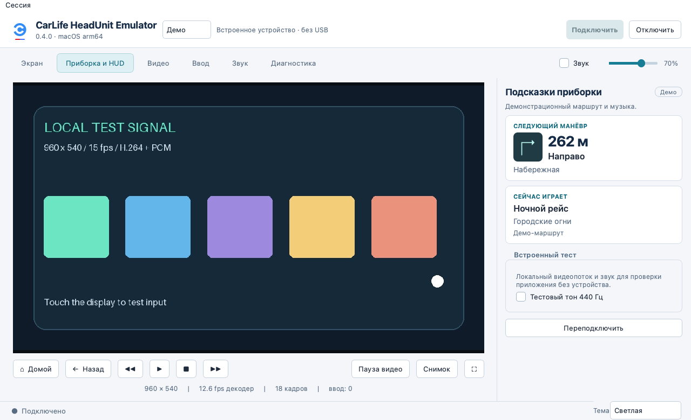
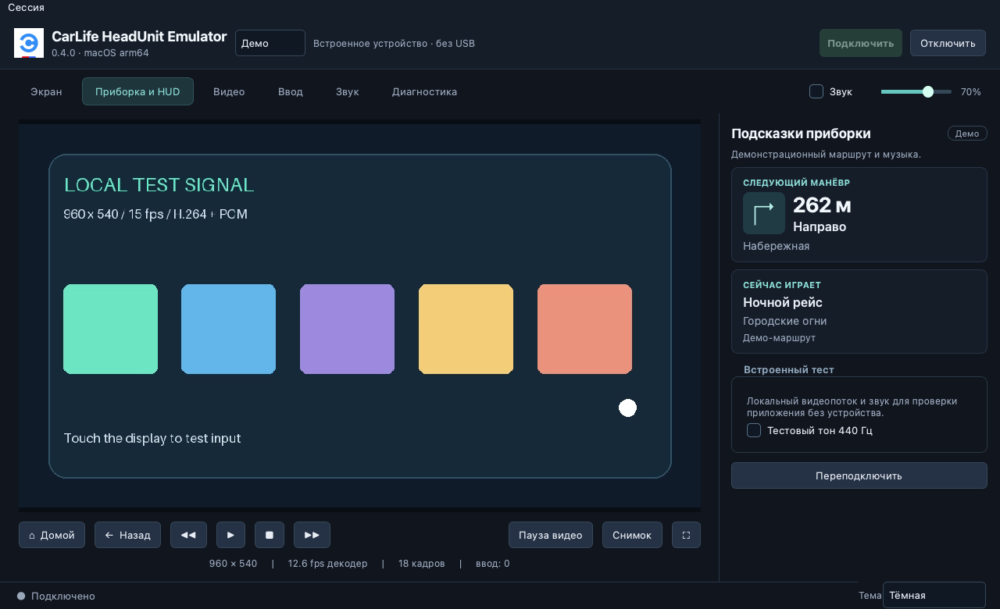

# CarLife HeadUnit Emulator

**Предварительный релиз 0.3.2-rc.3** · [English](README.md) · [Скачать RC3](https://github.com/SadykovIV/CarLife-HeadUnit-Emulator/releases/tag/v0.3.2-rc.3) · [Стабильная версия 0.3.1](https://github.com/SadykovIV/CarLife-HeadUnit-Emulator/releases/tag/v0.3.1) · [История изменений](CHANGELOG.md)

Независимое любительское приложение, которое эмулирует головное устройство Baidu CarLife для проверки совместимого телефона или Android-бокса. Показывает проекцию, воспроизводит принимаемый звук и передаёт касания, команды клавиатуры и медиакнопок. Выделено из [Carlife_on_box](https://github.com/SadykovIV/Carlife_on_box); macOS и Windows используют общий интерфейс Qt и одну логику сессии.

**Интерфейс приложения сейчас на русском языке.** Это не официальный продукт Baidu или Honda. Приложение не устанавливает компоненты Android и не изменяет прошивку устройства.

## Скачать и запустить

Выберите ZIP **0.3.2-rc.3** для своего компьютера. Python, Qt и необходимые для запуска библиотеки уже внутри.

| Скачать | Требования и запуск |
| --- | --- |
| [macOS arm64, ZIP](https://github.com/SadykovIV/CarLife-HeadUnit-Emulator/releases/download/v0.3.2-rc.3/CarLife-HeadUnit-Emulator-0.3.2-rc.3-macOS-arm64.zip) | Apple Silicon, **macOS 26+**. Распакуйте и откройте `CarLife HeadUnit Emulator.app`. |
| [Windows x64, ZIP](https://github.com/SadykovIV/CarLife-HeadUnit-Emulator/releases/download/v0.3.2-rc.3/CarLife-HeadUnit-Emulator-0.3.2-rc.3-Windows-x64.zip) | Распакуйте **всю папку** и запустите `CarLifeHeadUnitEmulator.exe` от обычного пользователя. Оставьте `runtime` рядом с EXE. |

Приложение macOS имеет локальную подпись ad hoc без нотариализации Apple. Windows-приложение и помощник не подписаны Authenticode.

[Контрольные суммы SHA256](https://github.com/SadykovIV/CarLife-HeadUnit-Emulator/releases/download/v0.3.2-rc.3/SHA256SUMS) · [Состав релиза и результаты проверок](https://github.com/SadykovIV/CarLife-HeadUnit-Emulator/releases/download/v0.3.2-rc.3/RELEASE.json) · [Исходники по тегу релиза](https://github.com/SadykovIV/CarLife-HeadUnit-Emulator/tree/v0.3.2-rc.3)

Чтобы попробовать приложение без устройства, выберите **«Демо»** в верхней строке подключения. Демо генерирует локальные H.264-видео и PCM-звук; оно не проверяет аппаратную совместимость. Также доступен аргумент `--demo`:

```sh
open "CarLife HeadUnit Emulator.app" --args --demo
```

```powershell
& '.\CarLifeHeadUnitEmulator.exe' --demo
```

## Возможности

### Приборка

Откройте **«Приборка» → «Запустить демо приборки»**. Через несколько секунд появятся стрелка направо, расстояние до поворота и название песни. Демо последовательно показывает разные манёвры, уменьшает расстояние и меняет трек. Машина и телефон для этой проверки не нужны.

Для проверки с телефоном выберите USB или TCP, нажмите **«Подключить»**, запустите маршрут и включите музыку на телефоне. Во вкладке **«Приборка»** эмулятор покажет данные, которые пришли по подписке CarLife. Источник должен поддерживать навигацию или музыку и передавать соответствующие сообщения. Если телефон передал изображение стрелки в PNG, приборка использует его. В остальных случаях она показывает знак по коду манёвра. Расстояние обновляется по сообщениям телефона. После завершения маршрута или отключения сессии показания очищаются.

### Первое подключение по USB на Windows

В верхней панели выберите **USB**, свой телефон и **«Подключить»**. Если указано **«требуется AOA»**, приложение запросит переход в режим аксессуара; USB ID может измениться. Обычное подключение не устанавливает драйверы. Комплектная `libusb-1.0.dll` — библиотека приложения. Штатный Android/Samsung-драйвер Windows может поддерживать MTP и ADB, но не давать приложению доступ к интерфейсу CarLife.

- **`18d1:2d00`** — аксессуар без ADB. Нажмите «Подключить»: мастер RC3 не настраивает этот ID. Включать отладку по USB ради CarLife не нужно.
- **`18d1:2d01`** — отдельные функции CarLife и ADB. Если подключение работает, оставьте драйверы как есть. Иначе завершите активную сессию и откройте **«Подключение» → «Настроить WinUSB…»**. Сверьте порт и **`USB\VID_18D1&PID_2D01&MI_00`**. Кнопка **«Зарегистрировать»** открывает приложениям путь к уже назначенному WinUSB; **«Назначить WinUSB»** может заменить драйвер только этого интерфейса. После подтверждения права администратора получает помощник, а не эмулятор. Затем нажмите «Подключить» вручную.

[Инструкция по первому подключению и ручной настройке через Zadig](https://github.com/SadykovIV/CarLife-HeadUnit-Emulator/releases/download/v0.3.2-rc.3/CarLife-Windows-first-connection-ru.txt). Вручную назначайте WinUSB только точно определённому CarLife **MI_00**, не составному устройству, MTP, модему или ADB/MI_01. Если виден только `&ADB` или отдельный MI_00 не подтверждён, не меняйте драйвер. Откройте **«Диагностика» → «Экспорт отчёта»**: там сохранены этап и исходная ошибка текущей попытки.

### Возможности приложения

- USB Android Open Accessory для выбранного устройства. **AOA всегда включён при USB-подключении**; сканирование списка не переводит устройства в accessory-режим. TCP поддерживает совместимый мультиплексированный лабораторный поток проекта, а не произвольный CarLife Wi-Fi.
- H.264-проекция, запрос разрешения/FPS, диагностика согласованного режима, вписывание/обрезка, поворот, полный экран и снимки. Принимаемый режим определяет устройство.
- Касания мышью и до **двух контактов** через pinch трекпада, Alt + перетаскивание мышью, Ctrl + колесо (на macOS также Cmd + колесо) или события сенсорного экрана Qt. По умолчанию — Legacy dual; Action3 выбирается явно для совместимого устройства.
- Принимаемый звук Media/TTS/VR, выбор устройства вывода, громкость, mute и необязательная запись PCM/WAV. Ввод с микрофона не реализован.
- Необязательная USB-клавиатура AOA 2.0 HID, отправка текста и вставка из буфера компьютера на устройство. Также доступны навигационные и медиакоманды.
- Тёмная, светлая и системная темы с выбором справа внизу; журнал сессии, счётчики и экспорт отчёта. Цвета входящего видео не меняются.

Подключение расположено сверху. Вкладки: **Экран**, **Подключение**, **Видео**, **Ввод**, **Звук**, **Приборка**, **Диагностика**.

### Светлая тема



### Тёмная тема



## Клавиатура, буфер и совместимость

Включите **«Клавиатура по USB»** до подключения. Этот флажок управляет дополнительным HID-вводом; основной транспорт USB AOA включён всегда. Регистрация клавиатуры начинается после установления потока CarLife. Устройство должно принять регистрацию клавиатуры AOA 2.0. Выберите **US** или **RU**, задайте такую же **раскладку физической клавиатуры на Android** и выключите **Caps Lock**. Перед вводом или вставкой щёлкните по нужному полю на изображении устройства.

Вставка передаёт локальный текст физическими нажатиями **только от компьютера к устройству**. Приложение не читает буфер Android, не синхронизирует буферы и не использует ADB. Поддержаны печатные ASCII-символы US или стандартная ЙЦУКЕН с предусмотренными цифрами и пунктуацией RU; произвольный Unicode, эмодзи и автоматическое смешивание раскладок не поддерживаются. Неподдерживаемый символ отклоняет всё отправление. За один раз можно отправить до 4096 символов; Enter и Tab сохраняют обычные действия поля. Текст не записывается в журнал сессии.

**Появление текста через HID на реальном устройстве пока не подтверждено.** При прежней проверке из исходников с одним устройством HeadSwap подтверждены USB-согласование, видео, регистрация и снятие HID. Мультитач также зависит от реализации устройства. Коммерческая OEM-аутентификация, Bluetooth HFP и универсальное подключение CarLife Wi-Fi не реализованы.

## Запуск из исходников

Используйте Python 3.13 и установите desktop-зависимости, чтобы были доступны видео и тесты Qt. Из корня репозитория на macOS/Linux:

```sh
python3.13 -m venv .venv
. .venv/bin/activate
python -m pip install -r requirements-hu.txt
python -m hu_lab.desktop --demo
```

На Windows создайте среду командой `py -3.13 -m venv .venv`; в двух последних командах вместо `python` укажите `.\.venv\Scripts\python.exe`. Для подключения к реальному устройству из исходников нужна нативная libusb (на Windows — 1.0.30). Для мастера настройки драйвера используйте полный Windows-пакет с помощником.

Для Linux с закреплёнными зависимостями используйте Python 3.13. У Linux wheel PySide6 6.12.0 обнаружена ошибка подсчёта ссылок сигналов на Python 3.11; она воспроизводится без кода приложения. Упакованное окружение macOS проверено отдельно. Сходная проблема заголовков сборки описана в [исправлении limited ABI в CPython](https://github.com/python/cpython/commit/9258f3da9175134d03f2c8c7c7eed223802ad945); какие именно заголовки использованы при сборке wheel, не подтверждено.

## Сборка

На Apple Silicon с нативным arm64 Python, после создания среды выше:

```sh
python -m pip install -r macos/requirements-build.txt
brew install libusb
./tools/build-mac-headunit
```

Результат: `dist/CarLife HeadUnit Emulator.app`. Сборщик проверяет архитектуру, локальную подпись, импорт компонентов и пути нативных зависимостей. `HU_PYTHON=/absolute/path/to/python` выбирает другой интерпретатор; `--libusb /path/to/libusb-1.0.dylib` — библиотеку.

Windows x64 собирается на macOS или Linux с Python, Pillow и инструментами LLVM (`clang`, `lld-link`, `llvm-dlltool`, `llvm-rc`). На macOS установите LLVM командой `brew install llvm`, затем:

```sh
./tools/build-windows-headunit
```

Сборщик скачивает зависимости и заголовки MinGW-w64 из [windows/dependencies.json](windows/dependencies.json), сверяет хеши, собирает приложение и помощник и создаёт переносимую папку и ZIP в `dist/`. Параметры `--cache-dir` и `--headers-cache-dir` задают папки для скачанных файлов, `--dist-dir` — каталог результата. При кросс-сборке Windows-программы не запускаются.

## Проверка

После установки desktop-зависимостей выполните полный набор тестов из корня репозитория:

```sh
python -m unittest discover -s tests -t . -v
python -m hu_lab.desktop --demo --smoke-test 8 --data-dir /tmp/carlife-smoke
```

Тесты используют локальные соединения и подменённые USB/Windows API. Без Qt/PyAV часть тестов интерфейса пропускается. Проверка демо сохраняет `smoke-report.json` и `smoke-window.png`; на Windows укажите доступную папку вместо `/tmp`. В готовом пакете `Verify.cmd` проверяет библиотеки и кодеки, `VerifyUsbRuntime.cmd` — комплектную USB DLL и системные API. Эти команды не проверяют доступ к конкретному телефону.

**Проверка RC3, 2 ноября 2026 года:** прошли 319 автоматических тестов. Распакованное macOS-приложение прошло проверку загрузки компонентов; для Windows проверены архив, x64-бинарники и зависимости DLL. Офлайн из ранее записанного USB-потока декодированы обновление трека и десять сообщений о его позиции. Новая приборка проверена на синтетическом маршруте; установка драйвера на физическом Windows-ПК и проекция после неё этим тестом не подтверждены.

Ради совместимости настройки и сессии сохраняют прежнее имя папки: `~/Library/Application Support/CarLife HeadUnit/` на macOS и `%LOCALAPPDATA%\CarLife HeadUnit\` на Windows. Путь можно переопределить через `--data-dir`.

Подробности управления, сборки и прежних аппаратных проверок — в [руководстве](docs/MAC_HEADUNIT_APP.md). Код проекта распространяется под [Apache-2.0](LICENSE); у зависимостей собственные лицензии. Официальная графика Baidu CarLife не входит в эту лицензию: см. [происхождение значка](hu_lab/assets/ICON_SOURCE.json), [NOTICE](NOTICE) и [сторонние компоненты](THIRD_PARTY_NOTICES.md).
